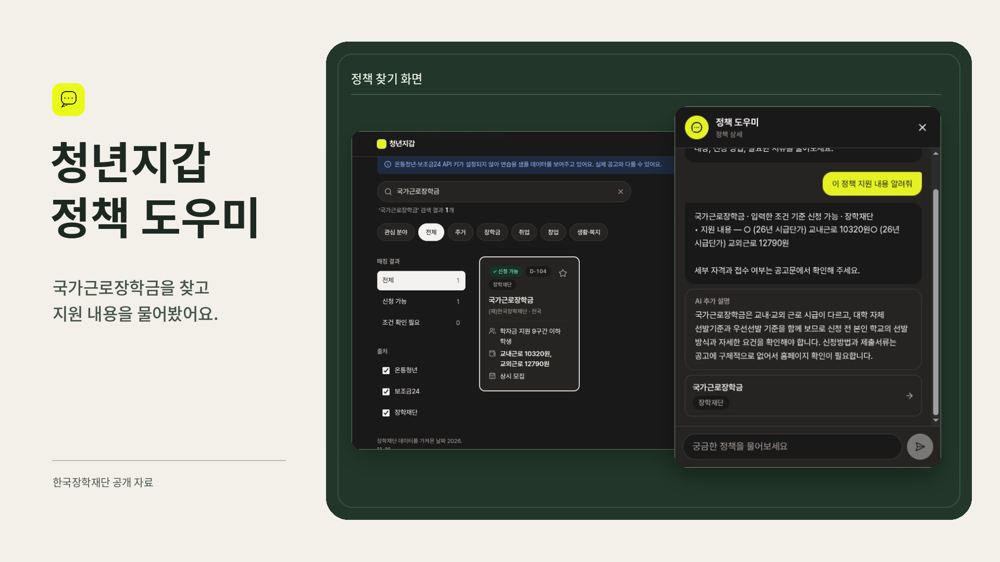

# 청년지갑 — 숨은 지원금 원스톱 매칭

`PRD.md`를 구현한 Next.js 앱입니다. 내 조건을 입력하면 온통청년·보조금24·한국장학재단 정책 중에서 신청할 수 있는 것만 골라 3줄로 요약해 보여 줍니다.

## 정책 도우미 시연

정책 대시보드에서 국가근로장학금을 찾아 지원 내용을 질문하고, 답변에서 공고 근거와 정책 상세 링크를 확인할 수 있습니다.



[시연 영상 보기 · 28초 MP4](docs/media/policy-assistant-demo.mp4)

## 실행

```bash
npm install          # postinstall에서 prisma generate 실행
cp .env.example .env # AUTH_SECRET, DATABASE_URL, DATABASE_URL_UNPOOLED 채우기
npx prisma migrate deploy  # Neon Postgres에 테이블 생성
npm run dev          # http://localhost:3000
```

> Prisma는 `.env`만 읽기 때문에 환경 변수를 `.env.local`이 아니라 `.env`에 둡니다. `.env*`는 `.gitignore`에 들어 있어 git에 올라가지 않습니다. 예외는 `.env.example`뿐입니다.

### API 키 없이도 동작
- **공공 API 키가 없을 때**: 출처별로 연습용 **샘플 정책**을 보여 주고, 화면에 안내 문구를 띄웁니다.
- **팩트챗 설정이 없을 때**: 원문에서 `지원대상:`, `지원내용:` 같은 줄을 그대로 옮겨 오는 **규칙 기반 데모 요약**을 씁니다. 화면에는 "데모 요약" 배지가 붙습니다.

키를 `.env`에 넣으면 실제 API와 팩트챗을 호출합니다. 실제 요청 파라미터와 응답 필드는 각 API 명세를 보고 `src/lib/sources/*.ts`에서 맞추세요.

## Vercel 배포

1. Vercel에서 이 저장소를 Import (Root Directory는 기본값 그대로)
2. Storage → **Neon** 연결 → `DATABASE_URL`, `DATABASE_URL_UNPOOLED` 자동 등록
3. Settings → Environment Variables에 `.env.example`의 나머지 값 등록 (`AUTH_SECRET`, `CRON_SECRET`, 팩트챗·공공데이터 키)
4. 배포하면 빌드 단계에서 `prisma migrate deploy`가 테이블을 만든다
5. 마감 알림은 `vercel.json`의 Cron이 매일 00:00 UTC(09:00 KST)에 `/api/cron/deadlines`를 부른다

DB 구조를 바꿀 때는 로컬에서 `npm run db:migrate`로 마이그레이션 파일을 만들고 함께 커밋한다.

## 테스트

| 명령 | 확인하는 것 |
|---|---|
| `npm test` | 단위 테스트 57개 — 매칭(지역·나이·기간·소득·정렬), 보조금24 지역 판단, 보안 함수 |
| `npm run test:notify` | D-3 테스트 정책으로 스케줄러를 두 번 돌려도 알림이 1개만 만들어지는지 |
| `npm run build` | DB 마이그레이션 적용 후 타입 검사와 프로덕션 빌드 |

## 구조

```
src/
  auth.ts                     Auth.js (이메일 + 비밀번호, JWT 세션)
  instrumentation.ts          매일 09:00(KST)에 node-cron으로 마감 알림 검사 (Vercel에서는 vercel.json의 Vercel Cron)
  lib/
    match.ts                  조건 매칭 (신청 가능 / 확인 필요 / 제외) + 정렬
    policies.ts               세 출처 통합. 6시간/하루 캐시, 하나가 실패해도 나머지는 보여 줌, 중복 정책 합치기
    sources/                  온통청년·보조금24·장학재단 응답 변환 + 샘플 데이터
      parse.ts                조건 추출 보조 함수, regionsFromAgency(보조금24 소관기관 → 지역 코드)
    summary.ts                팩트챗 호출, zod 검증, 실패 시 1회 재시도, 정책별 캐시, 하루 한도 90%에서 정지
    notifications.ts          D-7/D-3/D-1 알림 생성 (DB 고유 제약으로 중복 방지)
  app/api/...                 PRD 6-10 서버 API (+ /api/signup, /api/me 탈퇴, /api/cron/deadlines)
  app/...                     홈, 프로필 입력, 정책 목록·상세, 로그인·가입, 내 정책, 알림, 내 정보
prisma/schema.prisma          PRD 6-9 모델 + SourceCache, ApiUsage (Neon Postgres)
prisma/migrations/            배포 때 prisma migrate deploy가 적용하는 마이그레이션
vercel.json                   Vercel Cron (매일 09:00 KST 마감 알림)
```

## 참고
- 지역 목록(`src/lib/regions.ts`)에는 주요 시·군·구만 들어 있습니다. 전체 목록이 필요하면 행정표준코드 법정동 코드 파일로 바꾸세요.
- 한국장학재단 데이터는 매달 새 파일로 올라오고 그때마다 `KOSAF_API_URL`의 `uddi:` 부분이 바뀝니다. 최신 주소는 `https://infuser.odcloud.kr/oas/docs?namespace=15028252/v1` 에서 확인할 수 있습니다.
- 로컬에서 cron을 직접 실행해 보려면: `curl -H "Authorization: Bearer $CRON_SECRET" http://localhost:3000/api/cron/deadlines`
